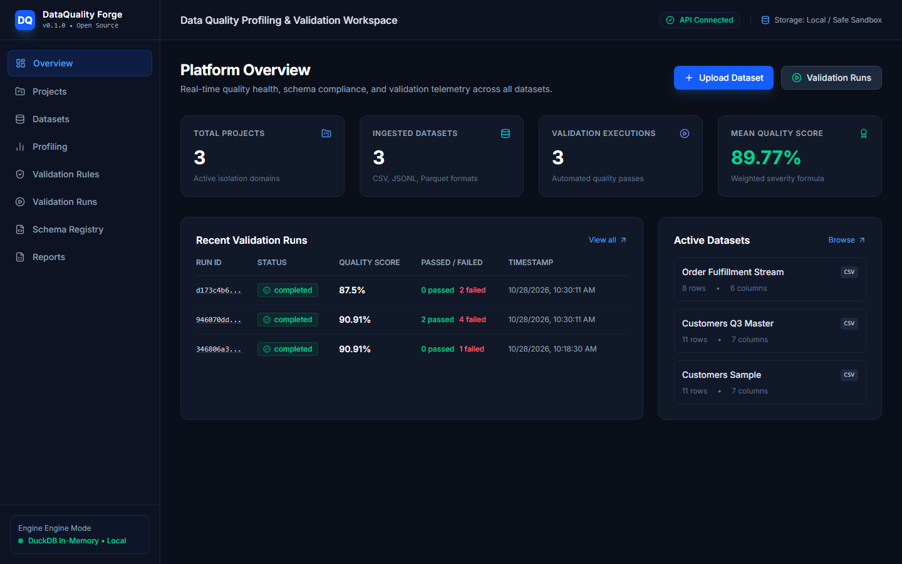
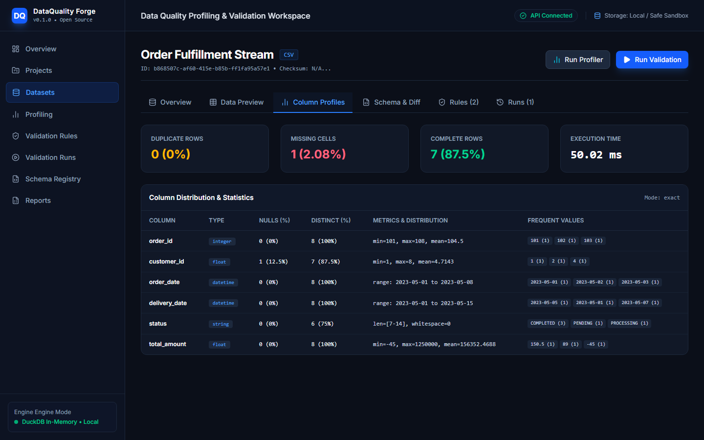
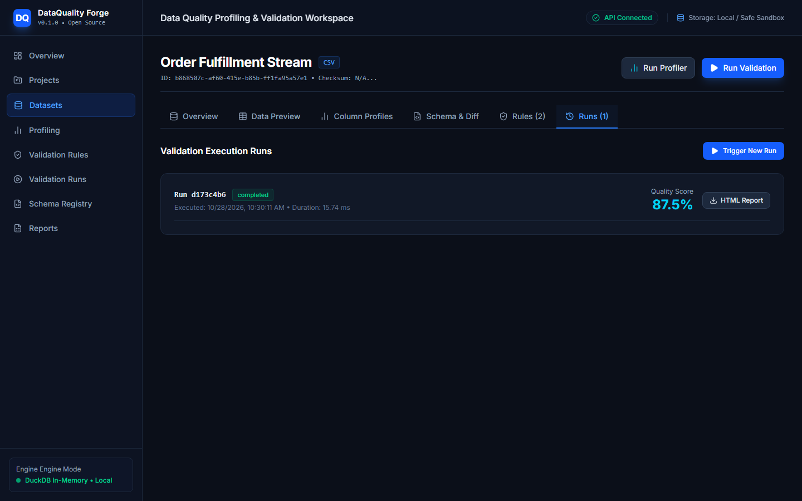
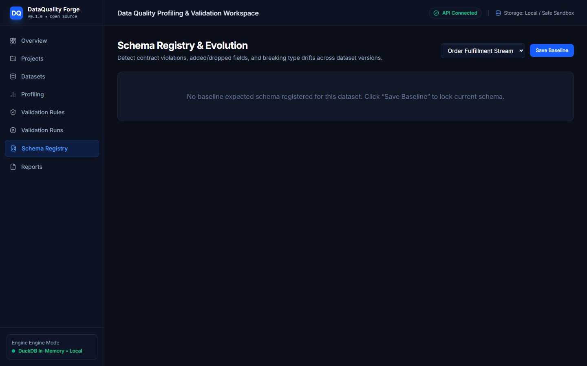

# DataQuality Forge 🛡️
### Open-Source Data Quality Profiling, Schema Governance & Automated Validation Platform

[](https://opensource.org/licenses/MIT)
[](https://www.python.org/)
[](https://react.dev/)
[](https://fastapi.tiangolo.com/)
[](https://duckdb.org/)
[](https://tailwindcss.com/)

**DataQuality Forge** is an enterprise-grade, privacy-first data quality platform engineered to profile distributions, detect data anomalies, enforce declarative validation rules, and monitor schema evolution across CSV, JSON, JSON Lines, and Apache Parquet datasets. Built with DuckDB and Pandas for blazingly fast in-memory execution, it operates 100% self-hosted with no mandatory external APIs or paid subscriptions.

---

## 📸 Platform Screenshots

### 1. Operations Overview & Telemetry Dashboard
Real-time quality health, aggregate mean scores, active dataset dimensions, and recent validation telemetry.


### 2. Deep Column Profiling & Anomaly Detection
Detailed exploratory statistics: quantile analysis, duplicate counts, missing rate, string length distributions, and frequent value histograms.


### 3. Automated Validation Execution & Rule Audit Trail
Multi-severity rule evaluation (CRITICAL, ERROR, WARNING, INFO) with transparent weighted scoring and sample failing records.


### 4. Schema Contract Registry & Evolution Tracking
Baseline schema comparison detecting breaking column deletions, additions, and incompatible type mutations.


---

## 📂 Repository Details

| Metric / Attribute | Specification |
|---|---|
| **Repository Name** | `dataquality-forge` |
| **Owner / Maintainer** | [`0xyz-exe`](https://github.com/0xyz-exe) |
| **Repository URL** | [https://github.com/0xyz-exe/dataquality-forge](https://github.com/0xyz-exe/dataquality-forge) |
| **Visibility** | Public (Open Source) |
| **License** | [MIT License](LICENSE) |
| **Default Branch** | `main` |
| **Primary Stack** | Python 3.11+ (FastAPI, DuckDB, Pandas) & React 19 (TypeScript, Vite, Tailwind CSS v4) |
| **Clone (HTTPS)** | `git clone https://github.com/0xyz-exe/dataquality-forge.git` |
| **Clone (SSH)** | `git clone git@github.com:0xyz-exe/dataquality-forge.git` |
| **Issue Tracker** | [https://github.com/0xyz-exe/dataquality-forge/issues](https://github.com/0xyz-exe/dataquality-forge/issues) |

---

## ✨ Key Features

- **Multi-Format Ingestion**: Ingest CSV, TSV, JSON, JSON Lines (`.jsonl`), and Apache Parquet with boundary checks, checksum hashing, and path-traversal sanitization.
- **Vectorized Data Profiling**: Compute exact or sampled summary metrics (duplicate rows %, missing cell %, complete row %) and column-level distributions (min, max, mean, median, quantiles, distinctness, empty/whitespace counts) powered by DuckDB.
- **10 Declarative Rule Families**:
  - *Completeness*: `not_null`, `max_null_percentage`, `not_empty_string`, `not_whitespace`
  - *Uniqueness*: `unique_column`, `unique_composite`, `no_duplicate_rows`
  - *Type & Parsing*: `is_type`, `parseable_as_type`
  - *Range & Bounds*: `min_value`, `max_value`, `value_between`, `string_length_between`
  - *Pattern Matching*: `regex_match`, `email_format`
  - *Categorical Sets*: `in_set`, `not_in_set`
  - *Date Integrity*: `not_future_date`, `start_before_end_date`
  - *Cross-Column*: `col_a_lte_col_b`
  - *Statistical Outliers*: Configurable IQR boundaries and Z-score standard deviation thresholds.
- **Explainable Quality Scoring**: Transparent severity weighting (`CRITICAL: 4.0`, `ERROR: 3.0`, `WARNING: 1.5`, `INFO: 0.5`) producing verifiable scores from 0 to 100%.
- **Schema Governance**: Automatic type inference, baseline contract registration, and breaking-change detection.
- **Reports & Artifacts**: One-click downloadable validation artifacts in JSON, CSV, and standalone self-contained HTML.
- **Headless CLI**: Standalone developer command-line utility for local assertions and CI/CD pipelines with deterministic exit codes (`0`, `1`, `2`, `3`).

---

## 🏗️ Architecture

```
┌────────────────────────────────────────────────────────┐
│                   Web Presentation                     │
│         React 19 + TypeScript + Tailwind CSS v4        │
└───────────────────────────┬────────────────────────────┘
                            │ REST API (JSON)
┌───────────────────────────▼────────────────────────────┐
│                    FastAPI Backend                     │
│  - Storage Ingestion      - Rules Registry             │
│  - Profiling Engine       - Quality Scoring            │
│  - Schema Diff Engine     - HTML/CSV/JSON Reporters    │
└─────────────┬──────────────────────────┬───────────────┘
              │                          │
┌─────────────▼─────────────┐ ┌──────────▼───────────────┐
│     DuckDB + Pandas       │ │    SQLite / PostgreSQL   │
│ In-Memory Data Processing │ │ App Metadata & History   │
└───────────────────────────┘ └──────────────────────────┘
```

---

## 🚀 Quick Start

### 1. Clone the Repository
```bash
git clone https://github.com/0xyz-exe/dataquality-forge.git
cd dataquality-forge
```

### 2. Docker Compose (Recommended)
Launch the entire platform including API, PostgreSQL, and React Web Dashboard:
```bash
docker-compose up --build
```
- Web Application: `http://localhost:3000`
- REST API Documentation: `http://localhost:8000/docs`
- Health Endpoint: `http://localhost:8000/health/live`

---

## 💻 Local Development Setup

### Backend (Python 3.11+)
```bash
# Create and activate virtual environment
python -m venv .venv
source .venv/bin/activate  # On Windows: .venv\Scripts\activate

# Install package and development tools
pip install -e ".[dev]"

# Start backend API server
uvicorn dataquality_forge.api.main:app --reload --port 8000
```

### Frontend (Node.js 20+)
```bash
cd apps/web
npm install
npm run dev
```

---

## ⌨️ CLI Usage

The DataQuality Forge CLI functions entirely standalone without requiring the web server.

```bash
# Display version
dataquality version

# Inspect file structure and top 5 rows
dataquality inspect ./examples/customers.csv

# Profile a dataset
dataquality profile ./examples/customers.csv

# Output profile as JSON
dataquality profile ./examples/customers.csv --json

# Run validation checks using rules file
dataquality validate ./examples/customers.csv --rules ./examples/rules_customers.json

# Export HTML validation report
dataquality validate ./examples/customers.csv --rules ./examples/rules_customers.json --export-html report.html

# Schema inspection and comparison
dataquality schema extract ./examples/customers.csv
dataquality schema compare ./examples/schema_expected.json ./examples/customers.csv
```

### Exit Codes:
- `0`: Validation passed with 0 blocking failures.
- `1`: Unexpected execution error.
- `2`: Invalid configuration or file not found.
- `3`: Validation completed with failing ERROR or CRITICAL rules.

---

## 🧪 Automated Testing

Run the full backend test suite:
```bash
pytest -v
```

All 9 test suites verify schema extraction, type coercion, profiling calculations, statistical outliers, cross-column assertions, scoring algorithms, and REST API endpoints.

---

## 🔒 Security & Privacy

- **Local-First Processing**: Dataset contents remain exclusively on your local or self-hosted filesystem.
- **Safe Sandboxing**: Randomized filenames, strict file extension allowlists, size limits, and path-traversal guards.
- **No Arbitrary Code Execution**: Rules are strictly declarative; no `eval()` or unsanitized runtime scripts.
- **Non-Root Containers**: Docker configurations run with minimal privilege baselines.

---

## 📄 License

This project is licensed under the [MIT License](LICENSE).
